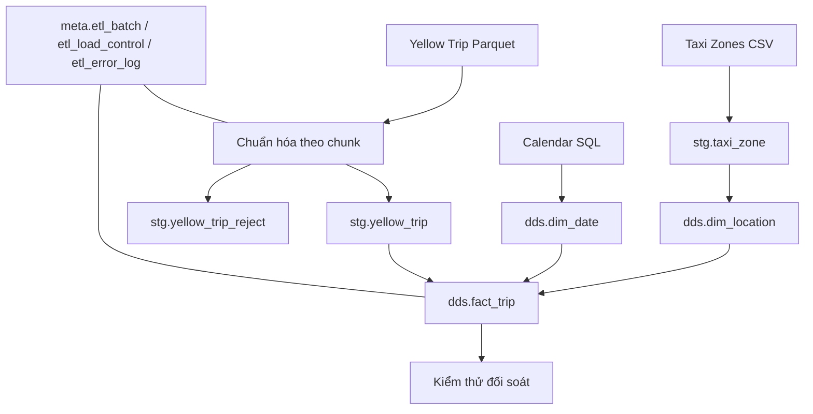

# PHẦN BÁO CÁO GIAI ĐOẠN 2 – KIẾN TRÚC, MAPPING, TỰ ĐỘNG HÓA VÀ KIỂM THỬ

## 1. Kiến trúc và phạm vi triển khai

Nhóm triển khai kho dữ liệu NYC Yellow Taxi theo kiến trúc Source → Staging → DDS trên SQL Server, database `NYCTaxi_DW`. Mage AI điều phối các tác vụ ETL; schema `meta` quản lý nhật ký và trạng thái nạp. Source gồm Parquet theo tháng, CSV Taxi Zones và Shapefile phục vụ bản đồ giai đoạn sau. Phạm vi ưu tiên là dữ liệu có mã PU/DO LocationID từ khoảng năm 2015, sau khi xác minh schema từng file; không khẳng định toàn bộ 2015–2026 đã được hỗ trợ hoặc nạp.

## 2. Data Mapping

Tài liệu `docs/mapping.xlsx` trong repo mô tả nguồn → Staging → DDS, quy tắc Reject và các pipeline. Các cột nguồn `VendorID`, `RatecodeID`, `PULocationID`, `DOLocationID` được chuẩn hóa thành `vendor_id`, `rate_code_id`, `pu_location_id`, `do_location_id`; `Airport_fee/airport_fee` được chuẩn hóa `airport_fee`. Ba trường phụ phí mới thiếu hoặc NULL được điền 0 theo code hiện tại. `stg_trip_id` là khóa BIGINT IDENTITY; `batch_id` INT, `source_file`, `source_row_number` truy vết ETL. Bảng reject lưu dữ liệu chuẩn hóa và `reject_reason` (nhiều mã cách nhau bằng dấu chấm phẩy), `rejected_at`.

Tại DDS đang triển khai, `dds.dim_location` tra theo location_id; Unknown có location_id=-1. `dds.dim_date` sinh lịch, khóa dạng YYYYMMDD; ngày được suy ra từ pickup_datetime. `dds.fact_trip` giữ grain một dòng trên mỗi dòng Staging hợp lệ, sử dụng hai khóa Location và một khóa Date, giữ vendor/rate/payment trực tiếp dưới dạng mã. Giá trị tiền và cự ly dùng DECIMAL(10,2), passenger_count TINYINT theo DDL thực tế. Lưu ý DECIMAL(10,2) không giảm dung lượng so với DECIMAL(18,2) trong SQL Server (cùng nhóm precision 10–19).

DDS hiện chỉ có hai Dimension vật lý, chưa đủ tám Dimension thiết kế giai đoạn 1; `trip_count`, `trip_duration` chưa là cột vật lý. Có thể tính số chuyến bằng COUNT_BIG(*) và thời lượng bằng chênh lệch ngày giờ, còn việc hoàn thiện mô hình cần nhóm xác nhận. Xem `docs/Doi_chieu_GD1_repo.md` để tránh mô tả sai hiện trạng.

## 3. Điều phối tự động hóa ETL

Pipeline `master_etl` nhận `period_key` dạng YYYY-MM, hoặc `auto`. Hàm `run_master` kiểm tra file đầu vào, calendar và khóa ứng dụng SQL Server; gọi các block thành phần theo thứ tự: đọc/làm sạch/nạp Taxi Zones → nạp Trip Staging và Reject → đồng bộ Dim Location → nạp Fact → đối soát. Dim Date được sinh bằng DDL như điều kiện trước khi chạy; bản chỉnh sửa mở lịch 2015–2026. Mỗi bước dùng lại hàm metadata của nhóm. Nếu lỗi thì dừng, không chạy bước tiếp theo. Các lần chạy master được tuần tự hóa bởi application lock; không chạy pipeline thành phần độc lập đồng thời.

Đối với dữ liệu lịch sử, file thiếu cột bắt buộc báo lỗi schema thay vì âm thầm bỏ qua. Chế độ `auto` tìm file Parquet cục bộ theo tên chuẩn, xử lý lần lượt những tháng chưa có cả hai trạng thái Success. Không tự tải file từ TLC; công tác đưa file nguồn đúng và đầy đủ vào thư mục là điều kiện vận hành. Chế độ tháng cụ thể vẫn đối soát khi cả hai tầng đã Success.

Tính idempotent: Staging kiểm tra `meta.etl_load_control` theo dataset + period_key, nếu chưa Success thì dọn phần nạp dở theo source_file; Fact kiểm tra control và thay thế theo kỳ trong một transaction. Dim Location đồng bộ cập nhật/insert, không DELETE các khóa đang được Fact tham chiếu. Zones xóa và nạp lại trong cùng transaction. Nếu bước nạp Staging lỗi, dữ liệu đã commit theo chunk có thể còn lại đến khi retry; không mô tả là rollback toàn bộ tháng. Không tự động sửa dữ liệu đã Success bị sai; cần điều tra và quy trình reload được nhóm duyệt.

Lịch chính thức đã cấu hình trên Mage v0.9.80: trigger `master_etl_daily`, tần suất Cron `0 19 * * *` theo UTC (02:00 ngày hôm sau giờ Việt Nam), runtime variable period_key=`auto`. Trigger đã từng active và được tạm tắt để nạp hai kỳ mở rộng; cần bật lại, `skip if running=true`; cần giữ Mage và SQL Server hoạt động, máy không ngủ. Cấu hình cuối cần được lưu lại bằng Update trigger in code trước khi commit. Hướng dẫn vận hành chung được tích hợp trong `README.md` (mục Master ETL).

## 4. Kiểm thử và đối soát

Test Plan `docs/Test_Plan_Huy.md` gồm 25 test case: kiểm tra count, tổng tiền, FK, NULL, grain, log, reject, schema evolution, retry, idempotency và lịch chạy. Script `08_master_period_checks.sql` xuất bảng PASS/FAIL theo kỳ. Hàm reconcile của master kiểm tra số dòng, tổng tiền, số tiền không NULL, lineage, khóa tham chiếu và metadata trước khi trả thành công.

Kiểm thử thực tế ngày 17–18/11/2026 trên SQL Server 2022 Express, ODBC Driver 17 và Mage v0.9.80: hai unit test `test_months`, `test_quality` đều PASS trong môi trường .venv (lần cuối 0,037 giây). SQL 08 đạt 12/12 PASS mỗi kỳ, tổng 60/60 lượt SQL. Đây là kết quả thực nghiệm, không còn chỉ là fixture chạy với stub. SQL 05 đạt thêm 6/6 kiểm tra đối soát toàn kho. Tổng cộng 68/68 lượt kiểm thử trong ba bộ Python, SQL 08 và SQL 05 đạt PASS. Kiểm thử thiếu file (TC16) và chuẩn hóa CBD fee (TC19) đã có minh chứng riêng; các test retry, schema lịch sử và overlap chưa được xác minh đầy đủ. Kết quả chi tiết được lưu trong `docs/Test_Plan_Huy.md`.

## 5. Kết quả thực nghiệm bản tích hợp

### 5.1. Số liệu nạp và đối soát

| Kỳ | Source read | Staging hợp lệ | Reject | Fact | Doanh thu Staging (USD) | Doanh thu Fact (USD) | SQL 08 |
|---|---:|---:|---:|---:|---:|---:|---|
| 2024-01 | 2.964.624 | 2.869.967 | 94.657 | 2.869.967 | 78.474.541,40 | 78.474.541,40 | 12/12 PASS |
| 2024-02 | 3.007.526 | 2.901.778 | 105.748 | 2.901.778 | 79.036.753,37 | 79.036.753,37 | 12/12 PASS |
| 2025-01 | 3.475.226 | 3.253.069 | 222.157 | 3.253.069 | 87.235.063,20 | 87.235.063,20 | 12/12 PASS |
| 2025-05 | 4.591.845 | 4.093.463 | 498.382 | 4.093.463 | 119.861.989,70 | 119.861.989,70 | 12/12 PASS |
| 2025-06 | 4.322.960 | 3.870.424 | 452.536 | 3.870.424 | 114.002.651,39 | 114.002.651,39 | 12/12 PASS |
| **Tổng** | **18.362.181** | **16.988.701** | **1.373.480** | **16.988.701** | **478.610.999,06** | **478.610.999,06** | **60/60 PASS** |

Tỷ lệ hợp lệ 92,52%, reject 7,48% (theo thống kê SQL 06). Số dòng đọc bằng tổng hợp lệ và reject; số dòng Staging hợp lệ bằng Fact, tổng tiền khớp đến cent. Kết quả ba kỳ ban đầu trùng số liệu tham chiếu của Cường trong repo ngày 17/11. Trước lần chạy đầu, Zones/Staging/Reject/Fact đều rỗng, Dim_Date có 4.383 dòng, Dim_Location có 1 dòng Unknown. Sau tháng 2025-01, Zones có 265, Dim_Location có 266, Dim_Date vẫn 4.383 dòng; Staging và Fact đều 3.253.069 dòng.

### 5.2. Kiểm thử chạy lại và Mage

- Chạy lại `python scripts/run_master_etl.py --months 2025-01` ghi nhận tháng đã nạp thành công và bỏ qua nạp lại; Staging/Fact 3.253.069 dòng, Reject 222.157, doanh thu 87.235.063,20 USD ở hai tầng; 7/7 checks True. Đây là minh chứng idempotency theo kỳ; chưa đối chiếu riêng surrogate key trước/sau.
- Run ID 1 (`master_etl_manual`, `period_key=2025-01`): Done, 1/1 block, 50,66 giây, log cho thấy 7/7 checks True.
- Run ID 2 (`master_etl_daily`, `period_key=auto`, Run@once): Done, 1/1 block test PASS, 10,13 giây. Thử trên thư mục đã nạp hết ba kỳ, Hai kỳ mở rộng sau đó đã đạt SQL 08; cần lưu log CLI auto để xác nhận riêng cơ chế phát hiện kỳ mới.
- Thử Scheduler với cron `*/2 * * * *`: Run ID 3 và 4 Failed sau khi sửa trigger làm mất runtime variable `period_key`. Khắc phục bằng thêm lại `period_key=auto` và đặt mặc định `period = kwargs.get('period_key') or 'auto'` trong `mage_etl/data_loaders/run_master_etl.py`. Run ID 5 được Scheduler kích hoạt lúc 17:32 UTC ngày 17/11 và Done, 1/1 block. Lịch đã được khôi phục về `0 19 * * *`, trạng thái active.

### 5.3. Kiểm thử bổ sung và đối soát toàn kho

**Kiểm thử thiếu file nguồn (TC16).** Chọn kỳ 2025-12 chưa có file trong thư mục nguồn. Lệnh `Test-Path` trả về `False`; khi gọi master với `--months 2025-12`, hệ thống phát sinh `FileNotFoundError` tại bước kiểm tra file đầu vào. Truy vấn `meta.etl_load_control` không trả về bản ghi cho kỳ này và số dòng Staging có tên file nguồn tương ứng bằng 0. Kết quả PASS: hệ thống dừng đúng khi thiếu đầu vào, không ghi nhận kỳ nạp thành công hoặc tạo dữ liệu Staging cho file thiếu. Đây là kiểm thử âm có chủ đích.

**Kiểm thử thay đổi schema (TC19).** Kiểm tra cột `cbd_congestion_fee` trong Staging theo năm:

| Năm | Số chuyến hợp lệ | Tổng CBD fee (USD) | Số NULL |
|---|---:|---:|---:|
| 2024 | 5.771.745 | 0,00 | 0 |
| 2025 | 11.216.956 | 5.993.834,50 | 0 |

Kết quả phù hợp quy tắc bổ sung giá trị 0 khi cột phụ phí mới không tồn tại trong dữ liệu cũ. TC19 đạt PASS trong phạm vi các kỳ 2024–2025 đã nạp; không suy rộng cho tất cả schema lịch sử.

**Đối soát toàn hệ thống.** Script `sql/05_tests/05_reconcile_checks.sql` đạt 6/6 PASS:

| Nội dung kiểm tra | Kết quả thực tế | Đánh giá |
|---|---|---|
| Số dòng Fact bằng Staging | 16.988.701 = 16.988.701 | PASS |
| Số ETL batch Failed | 0 | PASS |
| Batch Staging sai cân bằng read = loaded + rejected | 0 | PASS |
| Taxi Zones | 265 | PASS |
| Số dòng Staging bằng tổng rows_loaded trong log | 16.988.701 | PASS |
| SUM(total_amount) Staging bằng Fact | 478.610.999,06 USD ở mỗi tầng | PASS |

Truy vấn độc lập toàn kho cũng xác nhận số chuyến và tổng tiền giữa hai tầng khớp tuyệt đối. Không có ETL batch Failed trong metadata tại thời điểm kiểm tra không có nghĩa lịch sử Mage chưa từng lỗi: Run ID 3 và 4 vẫn được giữ làm minh chứng kiểm thử hồi quy.

| Bảng | Số dòng cuối cùng |
|---|---:|
| `stg.taxi_zone` | 265 |
| `stg.yellow_trip` | 16.988.701 |
| `stg.yellow_trip_reject` | 1.373.480 |
| `dds.dim_date` | 4.383 |
| `dds.dim_location` | 266 |
| `dds.fact_trip` | 16.988.701 |

### 5.4. Thống kê dữ liệu bị loại

Script `sql/05_tests/06_reject_statistics.sql` thực thi thành công, cung cấp thống kê theo file nguồn và lý do Reject. Đây là báo cáo thống kê, không phải bộ kiểm thử PASS/FAIL.

| Kỳ | Tỷ lệ Reject (%) |
|---|---:|
| 2024-01 | 3,19 |
| 2024-02 | 3,52 |
| 2025-01 | 6,39 |
| 2025-05 | 10,85 |
| 2025-06 | 10,47 |
| **Toàn kho** | **7,48** |

| Nhóm lý do Reject phổ biến | Số bản ghi | Tỷ lệ trong Reject (%) |
|---|---:|---:|
| `NEGATIVE_FARE` | 452.168 | 32,92 |
| `DISTANCE_LE_ZERO` | 412.146 | 30,01 |
| `NEGATIVE_FARE;INVALID_TOTAL_AMOUNT` | 293.767 | 21,39 |
| `DROPOFF_LE_PICKUP` | 130.822 | 9,52 |
| `NEGATIVE_FARE;DISTANCE_LE_ZERO` | 50.980 | 3,71 |

Tỷ lệ Reject tháng 5–6 năm 2025 cao hơn các kỳ năm 2024 đã khảo sát. Các nhóm lý do là giá trị nguyên vẹn của `reject_reason`, không phải tần suất độc lập của từng mã lỗi. Tiền âm có thể bao gồm giao dịch điều chỉnh; không kết luận tất cả các bản ghi bị loại là lỗi dữ liệu thực tế. Kết quả phản ánh chính sách ETL hiện tại và cần được cân nhắc khi phân tích doanh thu.

### 5.5. Tổng hợp trạng thái Test Plan

| Trạng thái | Số test case | Mã |
|---|---:|---|
| PASS – đạt trong phạm vi đã kiểm thử | 15 | TC01–TC13, TC16, TC19 |
| PARTIAL – kiểm chứng một phần | 4 | TC14, TC15, TC20, TC21 |
| NOT RUN – chưa thực hiện | 3 | TC17, TC18, TC22 |
| GAP – khác biệt với thiết kế GĐ1 | 3 | TC23–TC25 |
| **Tổng** | **25** | TC01–TC25 |

Python Unit Test đạt 2/2, SQL 08 đạt 60/60 (12 điều kiện trên 5 kỳ), SQL 05 đạt 6/6; tổng 68/68 lượt PASS chỉ tính ba bộ kiểm thử này. Không đồng nghĩa toàn bộ 25 test case đã PASS. TC14 chưa so sánh riêng surrogate key trước/sau; TC15 chưa lưu đối chiếu riêng các kỳ cũ khi nạp kỳ mới; TC20 thiếu log CLI chứng minh auto phát hiện kỳ mới; TC21 chưa thử chạy chồng. TC17–18 và TC22 cần môi trường thử nghiệm phù hợp. GAP là khác biệt thiết kế, không đồng nghĩa toàn bộ pipeline thất bại.

### 5.6. Minh chứng cần đính kèm khi ghép báo cáo PDF

| Mã | Ảnh minh chứng đã có / cần bổ sung |
|---|---|
| H01 | Số dòng trước ETL và sau lần nạp 2025-01 |
| H02–H04 | SQL 08 đạt 12/12 PASS cho 2025-01, 2024-01, 2024-02 |
| H05 | Terminal chạy lại 2025-01: skip và 7/7 checks True |
| H06 | Giao diện pipeline master_etl và Run ID 1 Done |
| H07 | Logs Run ID 1, tổng tiền và 7/7 checks True |
| H08 | Run ID 2 Done, 1/1 block test PASS |
| H09 | Scheduler Run ID 3–4 Failed và Run ID 5 Done sau sửa; cron chính thức, period_key=auto |
| H10 | Unit test lần cuối: Ran 2 tests in 0.037s, OK |
| H11 | Đã có: truy vấn số dòng toàn kho sau khi nạp năm kỳ; Git diff xác nhận lịch cuối đã lưu vào code vẫn cần kiểm tra |
| H12–H13 | SQL 08 đạt 12/12 PASS cho 2025-05 và 2025-06 |
| H14 | Cần bổ sung nếu còn lưu: log CLI auto phát hiện kỳ mới và bỏ qua kỳ cũ |
| H15 | Terminal kiểm thử thiếu file 2025-12 và kết quả truy vấn control rỗng, Staging 0 dòng |
| H16 | Truy vấn CBD fee theo năm và số NULL |
| H17 | SQL 05: 6/6 PASS và đối soát doanh thu toàn kho |
| H18 | SQL 06: thống kê Reject theo kỳ và lý do |
| H19 | Dung lượng data file và transaction log sau năm kỳ |

Bảng trên là danh mục minh chứng từ ảnh và log thực nghiệm đã cung cấp hoặc cần bổ sung, để nhóm chèn khi ghép báo cáo PDF; ảnh chưa được nhúng vào Markdown. Các kiểm thử chưa có minh chứng ghi PARTIAL hoặc NOT RUN, không đánh dấu 25/25 PASS.

## 6. Hạn chế và hướng hoàn thiện

So với GĐ1, repo hiện reject distance <=0/NULL, chưa loại bản ghi nghiệp vụ trùng hoàn toàn, chưa có đủ Dimension và phân nhóm. Cần thống nhất thiết kế với Hiệu/Cường trước khi thay đổi dữ liệu đã nạp. Các trường tiền NULL và giá trị không phù hợp kiểu dữ liệu cần xác minh; không khẳng định xử lý mọi ngoại lai. Phân tích MoM/YoY chỉ có ý nghĩa trên các kỳ đã nạp đầy đủ, với chính sách lọc thống nhất. Phạm vi thực nghiệm GĐ2 gồm năm kỳ 2024-01, 2024-02, 2025-01, 2025-05 và 2025-06. Hai kỳ tháng 5–6 năm 2025 đã đủ dữ liệu hợp lệ theo ETL hiện tại để so sánh MR2; phần phân tích nguyên nhân thuộc giai đoạn OLAP/BI. Sau năm kỳ, data file đã cấp phát 8.648 MB, sử dụng 8.594,50 MB; transaction log 5.640 MB. Data file chiếm khoảng 84,45% giới hạn 10.240 MB của SQL Server Express. Không nạp thêm kỳ trước khi đánh giá dung lượng hoặc chuyển môi trường phù hợp. Đối soát toàn kho đã hoàn tất. Cần xác nhận trigger chính thức đã được bật lại và lưu vào code sau đợt nạp mở rộng. Kết quả SQL theo kỳ không thay thế kiểm thử lỗi, retry, overlap hay xác nhận đủ tám Dimension.

## 7. Kết luận

Phần kiến trúc, Data Mapping, điều phối Master ETL và kiểm thử đã được xây dựng và thực nghiệm trên năm kỳ, từ Source đến DDS. Các kiểm tra cốt lõi về số dòng, khóa ngoại, NULL và tổng tiền đều đạt theo mô hình hiện tại. Scheduler đã tự kích hoạt thành công trong đợt kiểm thử sau khi khắc phục tham số bị thiếu. Kết quả đủ cơ sở bàn giao phần tích hợp cho các thành viên review; các kiểm thử mở rộng chưa hoàn tất và khác biệt thiết kế GĐ1 (khử trùng nghiệp vụ, chính sách cự ly, số lượng Dimension) cần được ghi nhận và thống nhất trước khi khẳng định hoàn thành toàn bộ thiết kế.
